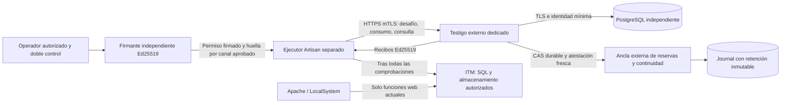

# ITM — Fase 2G-2B-1.8: diseño de infraestructura del testigo externo

Fecha de preparación: 19 de octubre de 2026, America/El_Salvador.

## 1. Resumen ejecutivo y decisión

**El canal real continúa bloqueado.** Este documento prepara una implementación
posterior; no acredita que exista infraestructura definitiva desplegada ni
autoriza instalar servicios o ejecutar una transición documental.

Arquitectura principal: **servicio testigo dedicado, PostgreSQL administrado
independiente y ancla de reservas/checkpoints bajo otra administración**, fuera
del host y de las credenciales de Laravel/Apache. El firmante mantiene una
cuarta frontera de custodia. Se recomienda un ejecutor de mantenimiento
separado del proceso web y, si la amenaza incluye LocalSystem comprometido,
también un host de ejecución separado. Una ACL local no aísla secretos frente
al administrador del mismo sistema.

Alternativa: **otro equipo físico o VM en otro host, administrado por un
operador distinto, con testigo y PostgreSQL autogestionados**, más la misma
ancla externa. Es viable si se financian respaldo, energía, monitoreo,
parches y recuperación. Otro contenedor o VM dentro del host Wamp, con el
mismo administrador y los mismos respaldos, no satisface la independencia.

La base transaccional evita dobles inserciones, pero **no impide que un
administrador restaure una copia antigua**. El ancla externa es una dependencia
de seguridad adicional y obligatoria del diseño recomendado. No está construida
ni contratada. Su indisponibilidad o continuidad no verificable cierra todo el
registro, incluso las consultas que pudieran responder `libre`.

## 2. Auditoría de partida y alcance de cambios

Se revisaron el informe 1.7 y sus seis PHP nuevos:

- `app/Contracts/TransporteTestigoDocumental.php`.
- `app/Exceptions/TestigoTiempoAgotado.php`.
- `app/Services/ProtocoloTestigoDocumental.php`.
- `app/Services/AdaptadorTestigoDocumental.php`.
- `tests/Support/TestigoProtocoloFicticio.php`.
- `tests/Feature/TestigoExternoDocumentalTest.php`.

También los cuatro PHP modificados en 1.7: `AutorizacionTransicionDocumental`,
`ConsumosAutorizacionDocumental`, `AutorizacionTransicionDocumentalTest` y
`SolicitudesPendientesBadgeTest`; la integración con `TransicionDocumental`,
el contrato `RegistroConsumosIndependiente` y la configuración documental.

Hallazgos conservados:

1. `AppServiceProvider` registra `RegistroConsumosNoDisponible`. El adaptador
   experimental también rechaza siempre `exigirDisponibleParaCanalReal()`.
2. El permiso firmado formato 2 incluye entorno, solicitud, lote, identidad,
   configuración del registro, artefactos y ventana. El consumo remoto ocurre
   antes de escribir el espejo exclusivo/sincronizado y antes de la acción.
3. V2 exige JSON canónico plano ASCII, firma Ed25519 con dominios distintos
   para reto/recibo, desafío fresco, nonce del testigo y vigencia de 30 segundos.
   El presupuesto total es 5.000 ms, sin reintentos automáticos de mutaciones.
4. Solo `resultado=nuevo` de un consumo corresponde a una ejecución nueva.
   El rechazo concurrente se verifica antes de generar `AUTORIZACION_CONSUMIDA`.
5. La consulta fresca y el espejo detectan restauraciones del cliente mientras
   el testigo conserva su estado. V2 no aporta una prueba externa contra
   restauración del propio testigo. No hay transporte HTTP/TLS implementado.

Se consultó Git con `git --no-optional-locks status` en modo de lectura, como
solicita esta fase. Hay numerosos cambios locales previos, incluidos archivos
modificados, eliminados y no seguidos. No se atribuyen a esta fase ni se
descartan. No se ejecutaron add, commit, push, reset, clean o worktrees.

Entregables nuevos de 1.8:

- Este informe técnico, contrato, configuración propuesta y manual futuro.
- `tests/Support/ModeloContinuidadTestigo.php`: experimento aislado con dos PDO
  SQLite `:memory:` y atestaciones Ed25519 ficticias del ancla.
- `tests/Feature/ContinuidadInfraestructuraTestigoTest.php`: siete casos de
  continuidad, restauración, incertidumbre y rotación simulada.

**No se modificó ningún archivo previo de aplicación, configuración o pruebas.**
No se añadió un cliente de red, una migración Laravel, un selector de backend
o configuración cargada automáticamente. El SQL y JSON de este documento son
especificaciones preparatorias, no archivos de despliegue ejecutados.

## 3. Componentes y fronteras de confianza



El firmante no administra el testigo ni comparte su clave privada. El testigo
no posee la clave privada del firmante. Artisan no administra PostgreSQL ni
el ancla; solo obtiene desafíos, consume y consulta. Apache no recibe claves
del firmante, testigo, ejecutor o ancla, ni credenciales administrativas.

El operador de aprobación y el operador de recuperación deben ser identidades
distintas del ejecutor técnico. Cambios de pins, épocas, permisos, retención
y recuperación requieren revisión por dos personas autorizadas. Ninguna cuenta
de ITM puede borrar consumos o reinicializar el registro externo.

La ancla debe tener almacenamiento, claves, administradores y recuperación
independientes de la réplica PostgreSQL. Una segunda tabla en la misma base
o una cadena de hashes dentro del mismo backup no añade esa frontera.

## 4. Alternativas y costos documentales

| Criterio | Otro equipo independiente | Servicio externo + PostgreSQL administrado (principal) | Servicio en infraestructura separada + disco persistente |
| --- | --- | --- | --- |
| Seguridad | Control local; exige hardening y custodia separada | Identidades mínimas, red privada, cuenta/proyecto ajeno a Wamp | Control del SO y discos; mayor responsabilidad de configuración |
| Independencia administrativa | Solo si hay otro administrador y host | Separar cuenta del testigo de ITM; separar también el ancla | Otra VM no basta si comparte root, snapshots o credenciales |
| Costos | Equipo, UPS, energía, red, repuesto y horas de operación | Cómputo + DB + ancla + backup + claves + alertas + personal | VM/discos + ancla + copias + operación DBA/SO |
| Complejidad | Alta en energía, respaldo, actualización y sustitución | Media/alta: menos operación de DB, más IAM y coordinación entre fronteras | Alta: DB, WAL, certificados, parches, capacidad y restauración propios |
| Disponibilidad | Depende de la sede y de su red; requiere recuperación alternativa | HA debe contratarse/diseñarse, no inferirse del plan mínimo | Una VM es punto único; redundancia aumenta costo y complejidad |
| Resistencia a restauraciones | Necesita ancla externa | Necesita ancla externa; DB gestionada no resuelve rollback malicioso | Snapshots de disco tampoco resuelven rollback; necesita ancla |
| Recuperación | Repuesto/backup + reconciliación con ancla | PITR en instancia aislada + reconciliación; nunca sustituir silenciosamente el registro | Reconstrucción de SO/DB/WAL + reconciliación |
| Auditoría | Debe exportarse fuera del equipo | Exportación a cuenta del ancla, acceso mínimo y retención | Debe sobrevivir al administrador y a los snapshots locales |
| Mantenimiento | Operador propio responsable | Servicio y políticas siguen requiriendo responsable humano | Mayor carga de SO, discos, DB y monitoreo |

Referencias verificadas en páginas oficiales al preparar este informe, **USD
mensuales de catálogo, sin impuestos ni contratación**:

- DigitalOcean publica una VM Basic regular de 1 GiB/1 vCPU a **USD 6/mes** y
  otra de 2 GiB a USD 12/mes. Son referencias de cómputo, no dimensionamiento
  aprobado ni garantía de independencia o disponibilidad.
  [Catálogo Droplets](https://www.digitalocean.com/pricing/droplets).
- Su tabla PostgreSQL Standard Basic regular publica **USD 15,15/mes** para
  el nodo de 1 GiB/1 vCPU, y una tarifa de almacenamiento de USD 0,215/GiB/mes
  en incrementos de 10 GiB. Confirmar el desglose exacto del carrito/región
  antes de presupuestar. No se presupone standby incluido.
  [Catálogo DB](https://www.digitalocean.com/pricing/managed-databases).
- La suma ilustrativa de las dos líneas de cómputo mínimas es **USD 21,15/mes**;
  **no es el precio de la arquitectura segura completa**. Faltan almacenamiento
  según desglose, respaldo, ancla CAS independiente, journal, certificados,
  custodia Ed25519, HA, tráfico, alertas y trabajo humano.

No se obtuvo una cotización verificable del servicio de ancla requerido ni
de custodia de claves, horas operativas o equipo/energía local. El total de
producción queda **pendiente de cotización y aprobación**. No se presenta un
rango supuesto como precio actual. Los catálogos deberán reconfirmarse por
región, moneda, disponibilidad y fecha en la fase de compra. No se crearon
cuentas, recursos externos, presupuestos comerciales o suscripciones.

## 5. Contrato de transporte autenticado propuesto

Se conserva la interfaz PHP existente:

```text
intercambiar(operacion, mensaje, plazoMilisegundos) -> {payload, firma}
```

Propuesta de binding HTTPS, aún no implementada ni normalizada externamente:

| Elemento | Regla obligatoria futura |
| --- | --- |
| Destino | Una URL base HTTPS aprobada, hostname exacto, puerto 443 y allowlist de egreso; no URL del permiso o de datos de usuario |
| Rutas | POST /itm-testigo/v2/desafiar, /consumir y /consultar; operación también vinculada en el mensaje canónico |
| TLS | TLS 1.3 preferido, mínimo TLS 1.2 con perfil aprobado; verificar cadena, vigencia, SAN hostname y revocación según PKI; ningún modo inseguro |
| Identidad del servidor | CA aprobada + hostname exacto; pin de identidad Ed25519 del testigo independiente de la PKI TLS |
| Cliente | mTLS, certificado individual con clientAuth y principal explícito; mapear identidad autenticada a SID aprobada fuera del cuerpo |
| Protección del principal | Rechazar SID declarada que no corresponda al principal autenticado; no confiar en headers suministrados por Internet |
| Proxy TLS | Preferir autenticación en el servicio; si termina en proxy, enlace interno autenticado, headers eliminados/recreados y origen único verificado |
| Redirecciones/proxy | Prohibir 3xx y redirecciones automáticas; no proxies heredados del entorno; no enviar credenciales a otro origen |
| Resolución | Resolver solo destino aprobado; bloquear cambios de origen y DNS rebinding mediante política de red/resolución aprobada; revalidar tras reconexión |
| HTTP | JSON UTF-8, Content-Type application/json; no cookies, caché o compresión de respuesta; Cache-Control: no-store |
| Tamaños | Petición y respuesta hasta 32 KiB de bytes sin compresión, headers hasta 8 KiB; payload canónico hasta 16 KiB, con límite durante lectura antes de decodificar |
| Plazo | 5.000 ms totales compartidos entre desafío y operación, incluido DNS/TCP/TLS/escritura/lectura; conexión máximo min(1.000 ms, restante) |
| Versión | Ruta v2 y formato=2 obligatorios; no negociar v1 o ignorar campos desconocidos |
| Duplicados | No reintentar POST automáticamente, incluidos reintentos de SDK, proxy, balanceador o TLS early data; deshabilitar 0-RTT en mutaciones |
| Nonces | Cada operación tiene desafío nuevo del cliente y reto único del testigo de 30 s; nonce usado no vuelve a estar disponible |
| Cuotas | Rate limit por principal y tamaño; no usar el rate limit como evidencia de consumo; proteger emisión masiva de retos |
| Logs | Solo código, correlación opaca y métricas mínimas; sin cuerpos, claves, tokens, certificados privados, SQL o datos personales |

Para una futura implementación basada en libcurl, la verificación de cadena
y la del hostname son controles distintos: exigir `SSL_VERIFYPEER=1` y
`SSL_VERIFYHOST=2`, sin opción de desactivarlos. El pin de clave pública del
testigo no reemplaza esas verificaciones TLS.
[Cadena](https://curl.se/libcurl/c/CURLOPT_SSL_VERIFYPEER.html),
[hostname](https://curl.se/libcurl/c/CURLOPT_SSL_VERIFYHOST.html).
El perfil TLS y la prohibición de early data en operaciones sensibles deben
revisarse conforme a [RFC 9325](https://www.rfc-editor.org/rfc/rfc9325.html).

mTLS se prefiere a un bearer token permanente en `.env`. Requiere PKI,
emisión individual, revocación comprobable y protección del material del
ejecutor. Una clave TLS puede ser RSA/ECDSA según PKI; no se reutilizan las
claves Ed25519 del permiso o recibo. Alternativa equivalente a evaluar:
identidad de workload con token de corta vida y prueba criptográfica de
posesión, audience exacta y revocación; no un secreto compartido de larga vida.

### Respuestas y errores

Los recibos válidos siguen usando exactamente los campos v2 y sus dominios
`ITM/testigo/v2/reto\0` y `ITM/testigo/v2/recibo\0`. No se agregan campos a
un payload v2: el cliente actual los rechazaría. Un rechazo de consumo ya
gastado debe llevar un recibo firmado `consumida/rechazado`, por ejemplo en
HTTP 409, que el transporte entregue al adaptador para su verificación.
HTTP 200 por sí solo nunca significa permiso concedido.

| Condición | Regla |
| --- | --- |
| CA no confiable, expiración, SAN incorrecto, revocación desconocida exigida | Abortar conexión; no enviar la solicitud ni hacer fallback |
| Certificado cliente/principal no autorizado | 401/403 sin información sensible; cliente falla cerrado |
| Protocolo/esquema inválido | 400/415/422 según contrato final; no reinterpretar como libre |
| Testigo/ancla no disponibles, 429 o 5xx | Cerrar; no consumir automáticamente después de esperar |
| Timeout o desconexión después de intentar enviar consumir | CONSUMO_REMOTO_INCIERTO, aunque no se sepa cuántos bytes llegaron |
| Respuesta incompleta, grande, alterada, no canónica o con firma incorrecta | Cerrar; si hubo envío de consumo, reconciliar como posible consumo |
| 3xx o versión distinta | Error, sin seguir Location ni renegociar |
| Consulta posterior | Nuevo reto; solo informa estado, no crea derecho de ejecución |

No se entrega cliente HTTP en 1.8. Los certificados incorrectos **no se
ensayaron con un handshake real**. Un doble que devuelva `tls_valid=true`
no acreditaría validación TLS. Las pruebas reales negativas de CA, SAN,
vigencia, clientAuth, revocación, redirección y límites de lectura son puertas
obligatorias de la futura implementación, inicialmente contra cliente falso
y después en laboratorio privado expresamente autorizado.

## 6. Persistencia transaccional propuesta

PostgreSQL dedicado, esquema separado y sin acceso desde Apache/Artisan.
TLS `verify-full` para DB, usuario del servicio de privilegios mínimos y
cuenta de migración distinta, utilizada solo durante cambios aprobados.
La verificación de cadena y hostname debe configurarse explícitamente;
no basta `sslmode=require`.
[PostgreSQL SSL](https://www.postgresql.org/docs/18/libpq-ssl.html).

Esquema lógico (no migración ejecutable en ITM):

| Entidad | Campos y restricciones esenciales |
| --- | --- |
| registro | registro_id PK; época aprobada; estado CERRADO/OPERATIVO/RECUPERACION; secuencia/hash de continuidad; generación de configuración; no inicialización automática al faltar |
| ejecutores | principal_id PK, SID única aprobada, identificador/huella de credencial, vigencia y revocación; lista de operaciones autorizadas |
| retos | nonce PK de 256 bits; registro/época, ID autorización, huella permiso/vínculo, lote, principal/SID, desafío cliente, operación, desde/hasta UTC, versión, bytes canónicos, usado; constraints de 30 s y tipos |
| reservas | autorización_id PK global dentro del registro estable; huellas, principal, lote, reto UNIQUE, secuencia ancla UNIQUE, estado RESERVADA/CONFIRMADA; nunca volver a libre |
| consumos | autorización_id PK y FK reserva; registro/época; huellas permiso/vínculo; lote y ejecutor; reto UNIQUE; versión=2; estado consumida; recibo_id UNIQUE; bytes exactos del sobre firmado; SHA-256 del recibo; consumido_en UTC; prueba de confirmación del ancla |
| auditoria | secuencia PK; evento mínimo; hash anterior/evento, correlación, principal opaco, resultado, fecha y checkpoint; exportación independiente; sin PDF o cuerpos de permisos |

Restricciones SQL conceptuales para `consumos`: `PRIMARY KEY(autorizacion_id)`,
`UNIQUE(recibo_id)`, `UNIQUE(reto_nonce)`, FK a reserva y reto, `NOT NULL` en
todos los vínculos, `CHECK(protocolo=2 AND estado='consumida')`. La partición
física por época no debe permitir reutilizar un ID antiguo: el catálogo
independiente de IDs gastados persiste entre épocas y rotaciones.

El CAS debe utilizar inserción exclusiva y restricción única; en PostgreSQL
puede usarse `INSERT ... ON CONFLICT DO NOTHING RETURNING ...` y comprobar
si se insertó realmente. No hacer `SELECT libre` seguido de escritura sin
restricción, ni `ON CONFLICT DO UPDATE` para sobrescribir consumos.
[INSERT](https://www.postgresql.org/docs/18/sql-insert.html).

Flujo futuro, con líder único y fencing comprobado por el ancla:

1. Autenticar principal, verificar mensaje/reto/tiempo y continuidad fresca.
2. Reservar duraderamente el ID en el ancla mediante CAS. El perdedor no
   obtiene un consumo nuevo. Una reserva es irreversible aunque falle la DB.
3. Dentro de transacción PostgreSQL bloquear el reto y verificar `usado=false`;
   marcarlo usado, insertar reserva/consumo, recibo firmado y auditoría.
   Usar commits duraderos y restricciones; cualquier error cierra y conserva
   la reserva externa. No emitir recibo `nuevo` antes de confirmar persistencia.
4. Confirmar en el ancla la secuencia, hash del evento y bytes exactos/huella
   del recibo persistido; el ancla retorna prueba firmada del checkpoint.
5. Guardar el checkpoint confirmado en DB; verificar correspondencia final
   DB/ancla. Solo entonces publicar el recibo v2 de consumo nuevo al cliente.

No existe una transacción atómica entre DB y ancla. Se escoge seguridad frente
a disponibilidad: un fallo entre pasos puede gastar un permiso sin ejecutar
nada y cerrar el registro hasta reconciliación. Un perdedor debe obtener un
rechazo firmado cuando el consumo ya esté confirmado y verificable; si está
solo reservado o la continuidad es incierta, obtiene error cerrado, nunca éxito.

Una consulta no inserta/modifica consumos o reservas. Puede gastar su propio
reto y producir auditoría, como sucede en v2. Debe leer estado confirmado con
consistencia fuerte y comprobar un head externo fresco antes/después de la
lectura; si cambió durante ella, cerrar o repetir **solo la lectura** de forma
acotada. Una lectura anterior a otro consumo puede devolver libre, pero la
ejecución siempre requiere ganar un nuevo CAS irreversible.

No se usan réplicas atrasadas para responder libre. Configuración WAL/fsync,
replicación y promoción deben garantizar el RPO aprobado; perder un commit
reconocido no puede quedar oculto bajo la misma identidad. Se prohíben DELETE,
TRUNCATE, reinicio de época y UPDATE de vínculos/recibos al usuario de servicio;
solo procedimientos controlados para estados monotónicos. El rol de auditoría
lee/exporta; el rol de respaldo no administra el ancla.

## 7. Protección frente a rollback y pérdida de continuidad

### Dependencia explícita y modelo de amenaza

El ancla es una autoridad adicional de **reserva única y continuidad**, con
CAS, consultas linealizables y journal durable protegido. Conserva por registro
estable todos los IDs reservados, sus vínculos y estados monotónicos, además
de secuencia/hash del último evento y recibos/checkpoints confirmados. Debe
estar fuera del alcance de quienes restauran PostgreSQL o el host ITM.

Cada consulta al ancla usa nonce aleatorio nuevo; su firma tiene dominio propio
y cubre identidad del ancla, registro, generación de confianza, secuencia,
hash, nonce y vigencia. Los pins se distribuyen por canal administrativo
independiente. Su contrato completo y su servicio **quedan por implementar**.
Un archivo `registro.json`, un head firmado guardado localmente o una mera
declaración `continuidad=true` no sustituyen una consulta fresca verificable.

La réplica debe demostrar que todos sus eventos/recibos coinciden con el head
del ancla, no solo copiar un contador. Recalcular/verificar el journal al
arranque y después de restauración; en operación verificar la cadena/Merkle
y las transiciones con fencing. Si falta un evento, sobra uno, cambia un
recibo, baja la secuencia o no se obtiene atestación fresca, pasar a CERRADO.
El modelo de pruebas recalcula el hash completo de sus pocas filas; no propone
ese costo como implementación de producción.

| Incidencia | Detección y regla |
| --- | --- |
| Backup antiguo del testigo/DB | El ancla conserva reservas/head posteriores; mismatch, cierre antes de responder libre |
| Pérdida de registros recientes | Reserva o secuencia externa sin equivalente; mismo cierre; no crear una DB vacía con identidad antigua |
| Clave anterior restaurada | Pin/generación/revocación externos no corresponden; cierre; no aceptar clave anunciada por el servidor |
| Reloj del servidor alterado | Comparar tiempo con fuente independiente autenticada y último estado aprobado; saltos hacia atrás o desfase fuera del umbral cierran emisión de retos; reloj monotónico para plazos |
| Recibo eliminado o sustituido | Hash del evento/recibo no coincide con journal/head externo; cierre incluso si el ID aún existe |
| Cliente y testigo restaurados simultáneamente | El ancla ajena a ambos conserva el consumo; el cliente no decide por sus archivos |
| Ancla caída o sin identidad verificable | CONTINUIDAD_NO_VERIFICABLE; no hay fallback a la DB local |
| DB restaurada y también ancla/pins/journal revertidos | Si TODA evidencia confiable se revierte no hay garantía criptográfica de detección; frontera incumplida, mantener cierre operativo y exigir auditoría externa |

El cliente v2 no incluye secuencia/head/prueba del ancla en su esquema cerrado.
El primer servicio compatible deberá comprobar continuidad en el servidor y
el cliente confiará en que el testigo cumple ese contrato. Para que Artisan
verifique directamente la prueba externa se requiere una especificación de
**v3 o una API externa separada**, revisada y autorizada; no se modificó v2
ni se inventó compatibilidad en esta fase. Este punto bloquea una afirmación
de verificación extremo a extremo independiente del servidor.

### Inmutabilidad y límites

Un journal WORM con retención definida ofrece evidencia histórica adicional.
Por ejemplo, S3 Object Lock distingue governance y compliance; compliance
impide eliminar/sobrescribir una versión protegida durante su retención,
incluso al root de esa cuenta. Governance tiene mecanismos de bypass y no
equivale a esa protección.
[Object Lock](https://docs.aws.amazon.com/AmazonS3/latest/userguide/object-lock.html),
[bypass governance](https://docs.aws.amazon.com/AmazonS3/latest/userguide/object-lock-managing.html).

Object Lock **no es por sí solo el servicio de ancla CAS ni prueba cuál es el
último head**. Versiones nuevas, omisión de eventos, pérdida de acceso, retención
vencida, cierre de cuenta y disponibilidad requieren diseño adicional. Un
checkpoint periódico asíncrono deja una ventana entre checkpoints: no garantiza
consumo único contra rollback de consumos recientes. La reserva sincrónica por
ID antes de permitir ejecución elimina esa dependencia de una ventana aceptada,
siempre bajo las garantías del ancla. No se promete resistencia a la colusión
de todos los administradores ni a un verificador reescrito por su administrador.

Objetivos de aceptación: **RPO lógico cero para IDs reservados** y cierre ante
incertidumbre; RTO de operación aún pendiente de acuerdo con responsables y
presupuesto. El ancla no puede restaurarse silenciosamente hacia atrás. Su
recuperación debe reconstruir toda la historia protegida y comprobar el último
head mediante evidencias fuera de su backup. Si no puede probarse completitud,
no reabrir ese registro ni reinterpretar IDs como libres.

## 8. Claves, identidades y permisos futuros

| Material/identidad | Custodia y acceso mínimo | Rotación, revocación y recuperación |
| --- | --- | --- |
| Privada Ed25519 del firmante | Estación/servicio firmante separado, idealmente offline; operador bajo doble control | Generación futura con CSPRNG aprobado; backup cifrado offline probado; revocación y nueva autoridad pública por canal independiente; no emitir con clave comprometida |
| Pública del firmante | Ejecutor y configuración aprobada, huella verificada fuera de banda | Archivo versionado de confianza, sin descarga TOFU; nueva clave exige revisión y permisos nuevos si cambia el contexto |
| Privada Ed25519 del testigo | Solo proceso firmador de recibos; no DB, Artisan, Apache ni operadores ordinarios | Almacén/HSM con soporte Ed25519 comprobado; backup/recuperación controlados; no asumir soporte de un KMS por su nombre comercial |
| Pública del testigo | Pin en configuración del ejecutor y registro aprobado | V2 solo admite una clave activa: parar servicio, aprobar cambio y actualizar contexto; conservar verificadores históricos sin aceptar la clave antigua para respuestas frescas |
| Clave y certificado mTLS del ejecutor | Almacén del ejecutor aislado; credencial individual, sin cuenta administrativa | Certificados de corta vida; revocación server-side inmediata y renovación bajo operador; nunca pasar privada en CLI/log/env de Apache |
| TLS del servidor/CA | Infraestructura testigo/PKI; SAN exacto y acceso de renovación mínimo | Rotar certificados TLS sin cambiar silenciosamente pins Ed25519; CA nueva distribuida por canal aprobado; comprobar vigencia y revocación |
| Identidad DB | Servicio testigo; procedimientos mínimos, sin DDL, DELETE o TRUNCATE | Rol de migración separado y temporal; credencial no copiada al ejecutor; restauración no cambia grants automáticamente |
| Clave del ancla y pública fijada | Otra frontera administrativa; no compartir con testigo | Rotación con transición de confianza aprobada, sin reiniciar historia; revocar generación anterior para operaciones frescas |
| Operadores | MFA, accesos nominativos y doble control para recuperación/pins/épocas | Altas/bajas auditadas; separación entre aprobación, despliegue, respaldo y ejecución |

No se generó ninguna de estas claves reales, cuentas o ACL. Las claves de
experimentos son ficticias y solo existen en memoria del proceso de pruebas.
La rotación de credenciales no es una rotación de autorización: no libera IDs
gastados, no reinicia secuencias y no cambia épocas para ocultar incidentes.

Los recibos históricos deben poder auditarse con las claves que estaban
vigentes al emitirlos. El código actual no tiene keyring histórico ni doble
firma de transición; implementarlos exige una fase posterior. No desplegar una
rotación que vuelva ilegibles los espejos existentes ni borre sus evidencias.

Cada clave privada futura requiere inventario, responsable, respaldo cifrado
con control de acceso separado, prueba de recuperación en laboratorio y
registro de acceso. No respaldar todas las privadas y sus pins/credenciales
en el mismo dominio de restauración. La pérdida del backup del ancla no
autoriza restaurar su historia a cero. Ante compromiso de firmante, testigo
o ancla: cerrar operaciones, revocar la credencial afectada, delimitar eventos
con evidencia independiente y aprobar la recuperación antes de emitir nuevos
permisos; conservar claves públicas históricas y auditoría de la revocación.

## 9. Configuración futura segura

Contrato propuesto de archivo privado, **no cargado por Laravel en esta fase**:

```json
{
  "schema": "itm-testigo-deployment/1",
  "environment": null,
  "endpoint": null,
  "allowed_addresses": [],
  "registry_id": null,
  "epoch": null,
  "protocol": 2,
  "witness_public_key_file": null,
  "witness_public_key_sha256": null,
  "executor_sid": null,
  "executor_principal": null,
  "tls_ca_file": null,
  "tls_client_certificate_file": null,
  "tls_client_key_reference": null,
  "anchor_identity": null,
  "anchor_public_key_file": null,
  "anchor_public_key_sha256": null,
  "approved_configuration_sha256": null
}
```

Todos los null/listas vacías son **inválidos para despliegue**, no defaults
confiables. No hay valor de ejemplo de endpoint, identidad o credencial que
pueda activar un backend. Se prefieren archivos/referencias de almacén de
claves a variables que contengan secretos. En el futuro podría haber una
única referencia no secreta `ITM_TESTIGO_CONFIG_FILE`, aún no implementada;
no se agrega ahora a `.env` o a `config/`.

El validador futuro debe exigir: ruta absoluta y canónica sin enlaces, fuera
de publicaciones HTTP y repositorio; propietario/permisos mínimos; contenido
aprobado con huella, esquema exacto y entorno explícito; claves públicas y
certificados válidos previamente aprobados; principal/SID conocidos; registro,
época y protocolo compatibles; destino/red fijados. Identidades dev/staging/prod
y sus claves/CA/DB/anclas deben ser distintas. Un secreto ausente no puede
activar un fallback local o ficticio.

Las constantes de política TLS, prohibición de redirects, tamaños y plazos
no serán opciones booleanas que el operador pueda desactivar. Cambiar el
archivo de configuración no deberá cambiar el binding de producción ni la
barrera por sí mismo. La disponibilidad requiere evidencia operativa y una
revisión de código/autorización aparte. Se conservan `.env`, configuración
documental, discos y proveedor actuales.

## 10. Recuperación operativa y nuevas autorizaciones

Regla general: detener acción, conservar originales, bloqueo y evidencias;
consultar con identidad válida y reto nuevo. No hay `desconsumir`, refund,
reinicio de registro, limpieza automática de espejos o reenvío automático
del mismo consumo. Una consulta nunca equivale a una autorización de ejecución.

| Incidencia | Procedimiento y condición de nueva autorización |
| --- | --- |
| Testigo desconectado | Cerrar antes de ejecutar; comprobar red/identidad/continuidad. Si no se envió consumo, revalidar dentro de la ventana; si pudo enviarse, tratarlo como incierto |
| Consumo remoto con respuesta perdida | Consultar testigo/ancla por el mismo ID. Consumida/reservada no vuelve a nueva; reconciliar SQL/archivos. Nueva ejecución exige nuevo ID y permiso revisado |
| Reinicio Artisan | Volver a validar permiso, entorno y espejo; consulta remota fresca. No usar estado de memoria o copia local antigua como prueba de libre |
| Interrupción durante transición | Mantener barrera; determinar estado real de SQL/archivos y si hubo commit; no presumir rollback. Reanudación exige plan compatible y autorización nueva |
| Error de persistencia | Si hubo reserva, conservarla gastada. Cerrar registro si DB/ancla divergen. Reconstrucción/reconciliación bajo operador; sin reembolso |
| Corrupción del registro/recibo | Cierre global, aislar réplica, conservar evidencia, contrastar journal/head externo; no reparar borrando filas |
| Pérdida de continuidad | Mantener CERRADO; investigar con operador independiente. Sin prueba de completitud no responder libre ni crear época nueva para continuar |
| Restauración de respaldo | Restaurar solo en entorno aislado; replay/reconciliación de TODAS las reservas posteriores; validar constraints, recibos, head y pins antes de promoción aprobada |
| Rotación de claves | Pausa, revocación/huellas por canal independiente, comprobar historia y permisos vinculados; no liberar consumos. Nuevos contextos/huellas requieren nuevos permisos |
| Cambio de infraestructura | Mantener registro e historia; congelar escritor, verificar último head, transferir con fencing y un solo líder; probar recuperación antes de cambiar destino aprobado |

Si una respuesta verificada muestra libre después de una incidencia previa al
consumo, sigue siendo necesaria una validación explícita vigente; no se ejecuta
automáticamente. Si hay reserva externa pero falta una fila local, la ancla
acredita ID gastado, no el derecho a ejecutar la transición pendiente.

La reversión de despliegue restaura binarios/configuración sin descartar
reservas, consumos, journal o claves históricas. Nunca restaurar la DB antigua
como mecanismo de rollback de aplicación. Si el nuevo esquema no es compatible
con el binario anterior, mantener el servicio cerrado y recuperar hacia delante.

## 11. Manual preparatorio para una fase autorizada posterior

**No se ejecutó ninguno de los pasos de despliegue siguientes.** Cada puerta
requiere evidencia revisada y autorización correspondiente; no son comandos
que deban pegarse en el host actual.

1. **Aprobar infraestructura y amenaza:** elegir proveedor/host, región,
   operadores, presupuesto completo, RPO/RTO, fronteras independientes y
   retención. Confirmar que ningún administrador local de ITM restaura el ancla.
2. **Identidades/permisos:** crear mediante autorización separada cuentas
   nominativas, roles de servicio/DB/migración/backup/ancla, MFA y egreso mínimo;
   revisar executor separado y ausencia de acceso desde Apache/LocalSystem.
3. **Instalación del testigo:** implementar/revisar servicio y transporte con
   versiones fijadas, artefactos verificados y SBOM; instalar primero en
   laboratorio aislado, sin datos/credenciales de ITM real.
4. **Persistencia:** crear esquema revisado en DB independiente de laboratorio,
   probar constraints y procedimientos con dos conexiones/procesos reales;
   configurar WAL/fsync, backup, TLS, fencing, roles y restauración probada.
5. **Claves:** ceremonia futura separada para firmante, testigo, ancla y PKI;
   validar soporte Ed25519 y recuperación; distribuir públicas y huellas fuera
   de banda. No generar secretos en un repositorio o en el proceso web.
6. **TLS/mTLS:** emitir certificados SAN/EKU correctos, configurar validación
   estricta y revocación, sin redirects/proxy inseguro/early data. Probar CA
   incorrecta, expiración, hostname erróneo y cliente no autorizado.
7. **Registrar ejecutor:** asociar principal mTLS con SID y ámbito de registro;
   negar otras identidades y toda administración de DB/ancla. No aprender
   identidad a partir de la primera solicitud o de un header no autenticado.
8. **Conectividad:** probar solo desde ejecutor aprobado a origen exacto;
   comprobar timeouts DNS/TLS/lectura, cuotas y streaming de tamaños; nada de
   `verify=false`, certificados tolerados o mensajes secretos en logs.
9. **Consumo único:** permisos ficticios, dos procesos simultáneos, nonce
   vencido/repetido, múltiples nodos y líder antiguo; máximo un `nuevo`, rechazo
   firmado o cierre seguro para el resto; consultas no crean consumos.
10. **Recuperación:** cortar antes/después de reserva, commit, confirmación y
    envío; matar procesos; restaurar DB y cliente antiguos; corromper recibos;
    rotar/restaurar claves. Verificar que no hay segundo derecho de ejecución.
11. **Continuidad:** implementar y revisar contrato del ancla, journal y head
    fresco; ensayar indisponibilidad, replay, pérdida de eventos y rollback de
    réplica. Decidir verificación servidor v2 versus futura prueba v3 aprobada.
12. **Activación controlada:** solo con autorización nueva de despliegue,
    pins/raíces/ACL aprobados, escritor único, restore de backup actualizado de
    las 29 tablas, auditoría de escritores y plan de mantenimiento. Eliminar
    el bloqueo del adaptador sería un cambio de código separado y revisado;
    no basta una variable. Desplegar el testigo tampoco autoriza la transición.
13. **Monitoreo/auditoría:** alertar por continuidad, latencia, indisponibilidad,
    secuencias, reservas pendientes, expiración/revocación y espacio; exportar
    evidencia mínima al dominio independiente; realizar simulacros programados.
14. **Reversión:** cerrar admisiones, conservar todos los IDs gastados y
    evidencias, revertir solo binarios/config aprobados si son compatibles;
    validar continuidad antes de reabrir. Ante duda, servicio cerrado y
    recuperación hacia delante; nunca borrar consumos para volver al estado anterior.

## 12. Pruebas y límites de lo verificado

El modelo nuevo tiene dos SQLite en memoria, una para réplica y otra para
ancla. Reserva el ID primero en el ancla y compara un hash de filas/recibos con
una atestación Ed25519 de head que cubre nonce nuevo y cantidad. Sus siete
casos prueban consulta sin mutación de consumos, reinicio simulado, restauración
antigua, interrupción tras reserva, recibo alterado, ancla caída/replay y
rotación explícita de pin sin liberar consumos. El último caso caracteriza
deliberadamente el fracaso de la garantía si también se restaura el ancla.

Este modelo **no es un servicio del ancla ni implementa el flujo completo de
confirmación/checkpoints, TLS, permisos, relojes confiables o persistencia**.
No comparte una API de consumo con producción ni se registra en el contenedor
de aplicación. Las funciones destructivas de restauración existen solo en
`tests/Support` para caracterización y rechazan su uso fuera de testing/SQLite.
Sus registros y claves desaparecen al terminar PHP; no hay puertos o archivos
de claves. Un clone comparte los PDO para simular cliente recreado, no prueba
reinicio de un servidor durable. Las pruebas v2 existentes cubren la integración
de autorización y motor SQLite y los dos reclamantes solapados.

### Ejecución realizada en esta fase

**167 pruebas, 1.046 aserciones, cero errores, fallos u omisiones**, confirmados
por salida PHPUnit y JUnit; duración aproximada de 47 segundos. Selección:
`ContinuidadInfraestructuraTestigoTest`, `TestigoExternoDocumentalTest`,
`AutorizacionTransicionDocumentalTest`, `RutasAutorizacionDocumentalTest`,
`TransicionDocumentalTest` y `SolicitudesPendientesBadgeTest`.

```text
php -d xdebug.mode=off -d memory_limit=512M vendor/phpunit/phpunit/phpunit --bootstrap tests/documentos-isolated-bootstrap.php --filter 'ContinuidadInfraestructuraTestigoTest|TestigoExternoDocumentalTest|AutorizacionTransicionDocumentalTest|RutasAutorizacionDocumentalTest|TransicionDocumentalTest|SolicitudesPendientesBadgeTest' --do-not-cache-result
```

El bootstrap fuerza SQLite `:memory:` efectivo, ausencia de DB_URL y
almacenamiento temporal antes de las migraciones ficticias. Las dos clases
nuevas superaron `php -l`. No se ejecutó una nueva pasada de toda Feature:
esta fase solo añade documentación y modelos/pruebas aisladas, y no modifica
código previo. El pase completo de 1.7 (1.165 casos) sigue siendo evidencia
de aquella fase, no se presenta como una ejecución nueva de 1.8.

### Integridad real verificada exclusivamente por lectura

La auditoría real se ejecutó en procesos separados de PHPUnit mediante
transacción MySQL `READ ONLY`, terminada con rollback; hashes deterministas
de filas, rutas y SHA-256 de PDF; hashes/ACL y consultas de servicios:

- Las **29 tablas** conservan conteos y hashes de todas las filas iniciales.
- Existen **8 inscripciones y 6 referencias documentales**; `documentos_inscripcion`
  conserva **cero filas**.
- Los **109 PDF** conservan rutas y SHA-256 antes/después. Además coinciden con
  el inventario histórico privado de fase 2D, cuya huella se verificó como
  `1592f563a0add3643a8b145fe2901361bfe213597b5167776523386e723ce283`.
  Los **103 sin asociación** permanecen en sus ubicaciones originales.
- Las cuatro opciones `enabled`, `history_enabled`, `legacy_read_enabled` y
  `transition_guard_enabled` continúan **false**. No hay caché de configuración
  real ni cambio de raíces/discos.
- `.env`, configuración documental/discos, packages/services y los siete
  archivos Apache/aliases/hosts revisados conservan hashes y ACL. Todos los
  archivos previos de `app`, `config` y `tests` conservan sus hashes y ACL.
- Las cinco raíces privadas conservan sus ACL e inventarios: documentos,
  cuarentena, autoridad y bloqueos vacíos; el padre de almacenamiento solo
  contiene `inscripciones`. No se crearon permisos, claves o documentos reales.
- Los servicios Apache/MySQL conservan estado, identidad y PID de servicio;
  no se recargaron ni reiniciaron.
- La segunda consulta Git solo muestra los **tres archivos nuevos** enumerados
  en este informe, además del estado local anterior que se conservó intacto.

Se retiraron **95 raíces temporales nuevas** de pruebas, comparadas con el
inventario previo, con patrones aleatorios exactos y límites absolutos bajo
TEMP, sin seguir junctions/reparse points. Se retiraron auxiliares, inventarios
de hashes y JUnit de `.phase18`, conservando temporales preexistentes. No se
copiaron PDF, respaldos, secretos o datos personales al informe. No hubo
escrituras MySQL, cambios de ACL/cuentas/servicios, despliegues o transición.

Puertas todavía sin ejecutar: handshake TLS/mTLS real, certificados negativos,
revocación efectiva, DB PostgreSQL, escritura durable ante corte de energía,
concurrencia multiproceso/multinodo, servicio de ancla real, pérdida de reloj,
HA/failover, recuperación fuera de todas las fronteras locales y custodia HSM.
No se presentan como pruebas aprobadas ni como garantías de la implementación.

## 13. Condiciones bloqueantes y estado del canal real

- Arquitectura, costo total, responsables, RPO/RTO y autorización de recursos aún pendientes.
- Servicio persistente, transporte mTLS y ancla de continuidad todavía no implementados/desplegados.
- Contrato del ancla, pruebas de completitud y decisión v2/v3 pendientes de revisión independiente.
- PKI, claves reales, pins, executor mínimo, ACL y mecanismos de revocación/rotación no provisionados.
- PostgreSQL real independiente, journal inmutable y restauración validada no disponibles.
- Precondiciones documentales anteriores: raíces y marcadores aprobados, respaldo actualizado con restauración aislada verificada, inventario HTTP, exclusión de escritores y mantenimiento de barrera pendientes.

El binding de producción conserva `RegistroConsumosNoDisponible`; el adaptador
experimental conserva su rechazo del canal real. No se cambió `.env`, no se
habilitó la barrera ni las opciones documentales. Los originales siguen en su
ubicación y publicación histórica. Este diseño no autoriza su traslado.

**Fase 2G-2B-1.8 terminada.** Se detiene el trabajo; despliegue y transición
requieren autorizaciones posteriores independientes.
